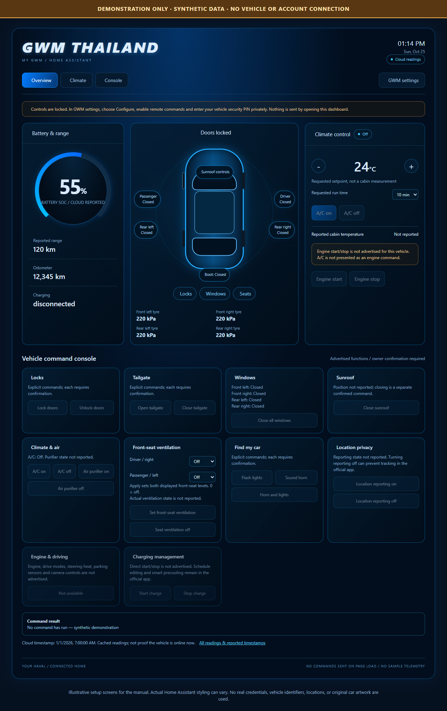
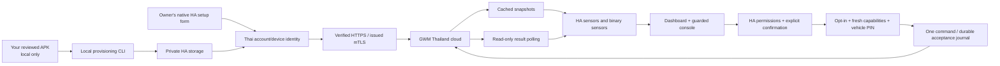

# GWM Thailand Connect

A community **Home Assistant custom integration for Thailand-market GWM vehicles**, with a Haval-oriented dashboard, cached vehicle telemetry, and optional, individually confirmed remote controls.

**Independent community project. Not affiliated with or endorsed by GWM, Haval, Home Assistant, or HACS.** Manufacturer cloud access can change or stop working. This is not a safety, security, or real-time vehicle-monitoring system.

## Preview

**DEMO / SYNTHETIC DATA.** The documentation dashboard renders the real card with a disconnected mock adapter. Setup screens are labelled illustrations, not screenshots of a real account. No owner account, VIN, location, original vehicle artwork, or OEM logo is used. The car silhouette and neutral integration icon are original drawings.

## Status and scope

| Area | Support |
| --- | --- |
| Market | Thailand only; protocol reviewed against My GWM Thailand `com.gwm.tha` 3.0.8 |
| Reference vehicle | Thailand Haval H6 PHEV; other models need independent compatibility testing |
| Account sign-in | Linked contact + verification code, or official account password |
| Telemetry | Battery SOC, range, odometer, doors/boot, locks, A/C, charging indicators and tyres when reported |
| Cabin temperature | Unknown when absent; requested A/C temperature is not a measurement |
| Remote commands | Off by default; owner PIN, current capabilities, permissions and confirmation required |
| Engine start/stop | Not implemented; never substitute A/C activation for engine start |
| Charging start/stop and schedules | Not implemented |
| Journey map / parking history | Compact local OpenStreetMap, recent car status and seven-day history in 0.3.0 development builds; not in released 0.1.0 |
| Distribution | HACS custom repository or manual installation; default-store review is separate |

The protocol foundation has been exercised against the manufacturer's service during private development, including normal owner verification and cached reads. **This separate public adapter is validated using synthetic tests, not a claim of a currently connected owner vehicle or verified physical command execution.** No physical vehicle command was executed by the project assistant. See [testing boundaries](docs/development.md#validation-boundaries).

## Quick installation

Requires **Home Assistant 2026.10.0 or later**. Back up Home Assistant before installing custom components.

1. In HACS, open **Custom repositories** and add:
   `https://github.com/zangkasi55/gwm-thailand-connect`, category **Integration**.
2. Install **GWM Thailand Connect**, then restart Home Assistant.
3. Obtain your own lawful copy of the reviewed official Thai APK. On a trusted local computer, generate the private provisioning JSON using [the installation guide](docs/installation.md#2-generate-private-provisioning).
4. Open **Settings > Devices & services > Add integration > GWM Thailand Connect**.
5. Import that JSON, select the login method, confirm the session warning, and enter any verification code **only in Home Assistant**.
6. Keep remote controls disabled until you have checked the readings against the official app.
7. Add the optional [dashboard and sidebar item](docs/installation.md#5-add-the-dashboard).

Manual installation from the release archive is also documented. A HACS custom repository can be installed before default-store inclusion; it is **not** evidence of HACS or Home Assistant endorsement.

## Release and catalog status

- **Public release:** [v0.1.0](https://github.com/zangkasi55/gwm-thailand-connect/releases/tag/v0.1.0), including an installable source-only ZIP and SHA-256 checksums.
- **HACS / Home Assistant custom-integration catalog:** [submission PR #12628](https://github.com/hacs/default/pull/12628). Submitted for maintainer review; **not yet approved or included by default**. Install through a custom repository in the meantime.
- **Built-in Home Assistant Core:** not submitted. [Core's requirements](https://contributors.home-assistant.io/core/integrations/create/#does-it-belong-in-core) include a separately published PyPI API library, a minimal initial integration and Bronze-quality compliance. This repository is a custom integration, not a claim of Core inclusion.

The release was published after the repository's Checks, HACS validation (without ignores), and official Hassfest workflows passed.

## Documentation

- [Illustrated installation manual](docs/installation.md): HACS/manual installation, private provisioning, code/password setup and dashboard.
- [User guide](docs/user-guide.md): readings, unknown states, optional PIN controls and confirmation.
- [Troubleshooting](docs/troubleshooting.md): delayed codes, certificate continuation, `310022`, `570062`, `607501`.
- [Architecture and diagrams](docs/architecture.md): trust boundaries, login state machine and command sequence.
- [Journey map and stop classification](docs/journeys.md): private observed routes, estimated parking, door intervals and per-stop battery.
- [Development, tech stack and build](docs/development.md): tests, screenshots, source-only ZIP, CI and release.
- [Contributing](CONTRIBUTING.md), [security and privacy](SECURITY.md), [license/provenance](NOTICE.md).

## Architecture at a glance

## Privacy and certificate policy

- No passwords, codes, vehicle PINs, application signing secrets, OEM bootstrap private keys, account certificates, APKs, captures, or real vehicle images are distributed.
- Public certificate/artifact fingerprints and **freshly generated synthetic test certificates** document compatibility without publishing a usable OEM identity.
- Provisioning is private input generated locally, not a downloadable resource.
- The generated private key is encrypted at rest, but its unlocking material and cloud tokens live on the same HA host. **This does not protect against a compromised HA administrator, host, or backup.**
- Code login does not retain an account password or one-time code. Password login retains the account password in HA's private configuration; optional remote controls retain the vehicle PIN in HA options.
- Diagnostics intentionally omit identifiers, credentials, tokens, PINs, keys and locations. Review all diagnostics before sharing.
- Normal system HTTPS trust, hostname verification and modern TLS remain enabled. There is no `verify=False` or weak-TLS workaround.

## Upgrading and compatibility

This project uses the new domain `gwm_thailand_connect`. It does not overwrite or automatically migrate any `gwm_ora` integration or private experimental build. Avoid configuring the same GWM account in two integrations: a new login can replace the phone app or another integration session.

## Contributing

Start with [CONTRIBUTING.md](CONTRIBUTING.md). Useful contributions include synthetic fixtures, additional model compatibility reports without identifiers, translations and reproducible bug fixes. Never put app material, credentials, raw account responses, locations or APK contents in a pull request.

MIT-licensed software; original upstream attribution is retained in [LICENSE](LICENSE) and [NOTICE.md](NOTICE.md).
