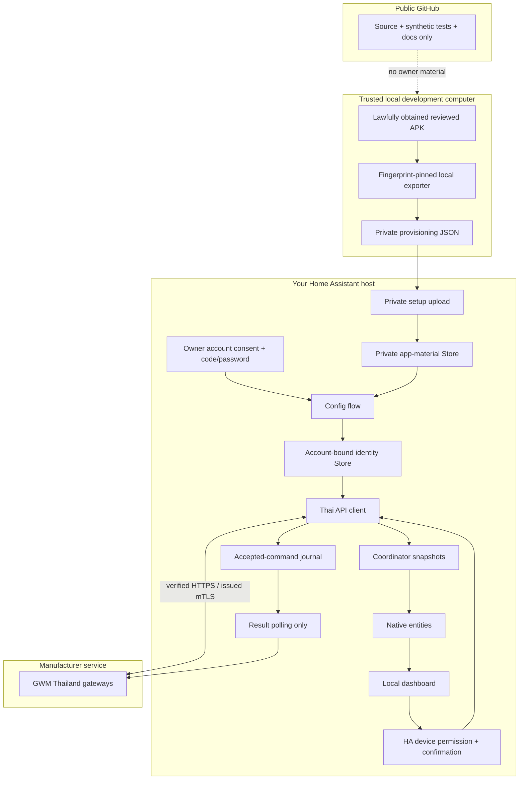
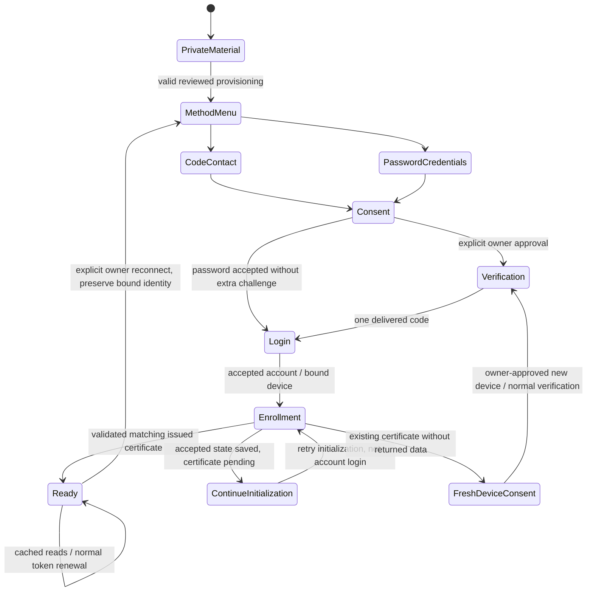
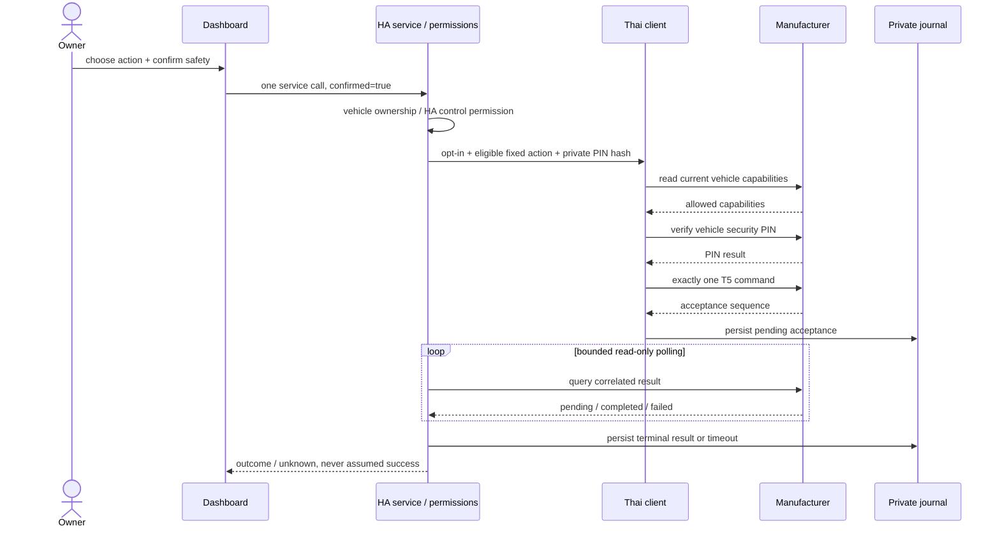

# Architecture, protocol and trust boundaries

## Components / tech stack

| Layer | Technology and responsibility |
| --- | --- |
| HA adapter | Python 3.14, native config/options flows, typed config entry, `DataUpdateCoordinator` |
| Persistence | HA private atomic `Store`, per-account serialized updates |
| Wire client | `aiohttp`, fixed Thai endpoint allowlist, bounded responses/deadlines |
| Identity | `cryptography`, RSA-2048/SHA-256 CSR, issuer/key/account/device binding checks |
| Transport | System HTTPS server trust, hostname validation, TLS >=1.2, security level >=2 |
| Entities | Native sensors/binary sensors with strict missing/unknown behavior |
| Frontend | Dependency-free JavaScript ES module, native custom element, CSS-only vehicle drawing |
| Tests | pytest, pytest-asyncio, scripted transports, generated synthetic identities; Node test runner |
| Development only | Ruff, mypy, Playwright screenshot generator, Shapely offline basemap builder |
| CI | GitHub Actions, Hassfest, HACS validation |

Runtime does not need Node, Playwright, an Android device or an emulator.

## Data and privacy boundary

Private app provisioning is never a static frontend resource. Neither diagnostics nor entity attributes expose account credentials, VINs/locations from diagnostics, tokens or PINs. Vehicle identifiers are still needed locally for HA's device registry and private account journal.

Encrypting the generated device key is not a substitute for protecting the host: its unlocking material, access tokens, optional PIN and any account password are on the same HA installation.

## Login state machine

A forced owner reconnect deliberately bypasses an old access session but preserves its valid bound issued key/certificate. No old access token is attached to normal login/code-request headers. An accepted login for a different manufacturer account ID is rejected instead of reusing that certificate across accounts.

`607501` is not treated as ordinary refreshable token expiry. Updated-agreement response `570062` does not imply consent and is never accepted automatically.

## One-shot command sequence

Cancellation after acceptance does not intentionally discard the journal save. On restart, pending accepted sequences are queried without resending a physical command. A result is accepted only when its sequence and instruction type match the original request.

## Protocol boundaries

Public source contains protocol structure and artifact/certificate **fingerprints**, not app key/secret values or OEM private material.

| Purpose | Host |
| --- | --- |
| Account authentication / PIN verification | `ap-h5-gateway.gwmcloud.com` |
| Issued client-mTLS vehicle reads/commands | `ap-app-gateway.gwmcloud.com` |
| Certificate enrollment | `ap-app-gateway-common.gwmcloud.com` |

Reviewed request signing uses path-only native signing, Java form encoding and bounded ASCII-whitespace normalization. The local identity codec uses independently structured DER/bit decoding and standard `cryptography` RSA recovery/CRT APIs. No decompiled program or third-party key resource is bundled.

Only fixed known operations are allowed: normal password/code login, token refresh, enrollment, vehicle discovery, cached status, capabilities, PIN verification, one T5 command and correlated result reads. Arbitrary URLs, forced status wakes, guessed revocation and unsupported actuator endpoints are not exposed.
