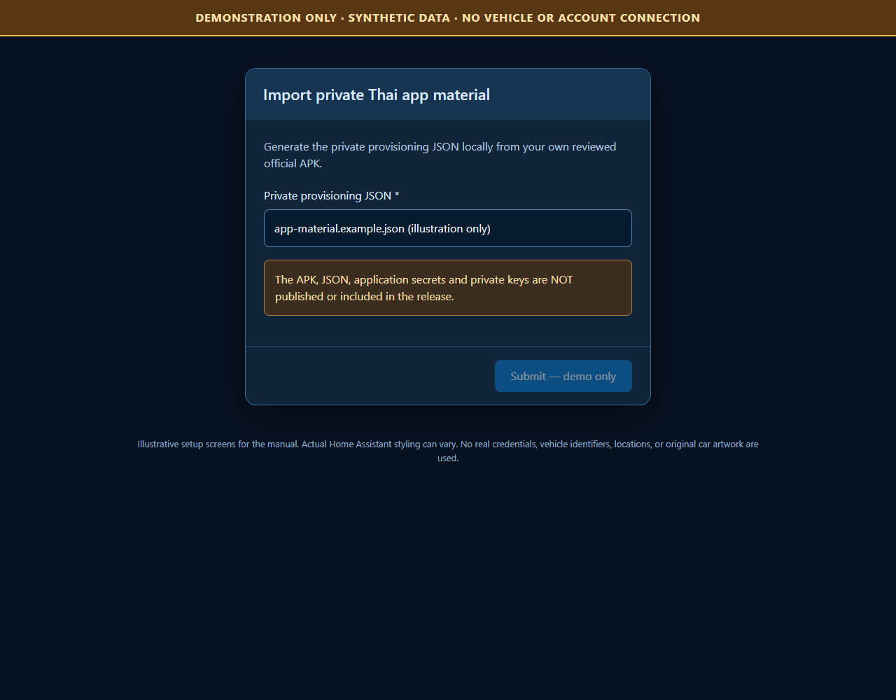
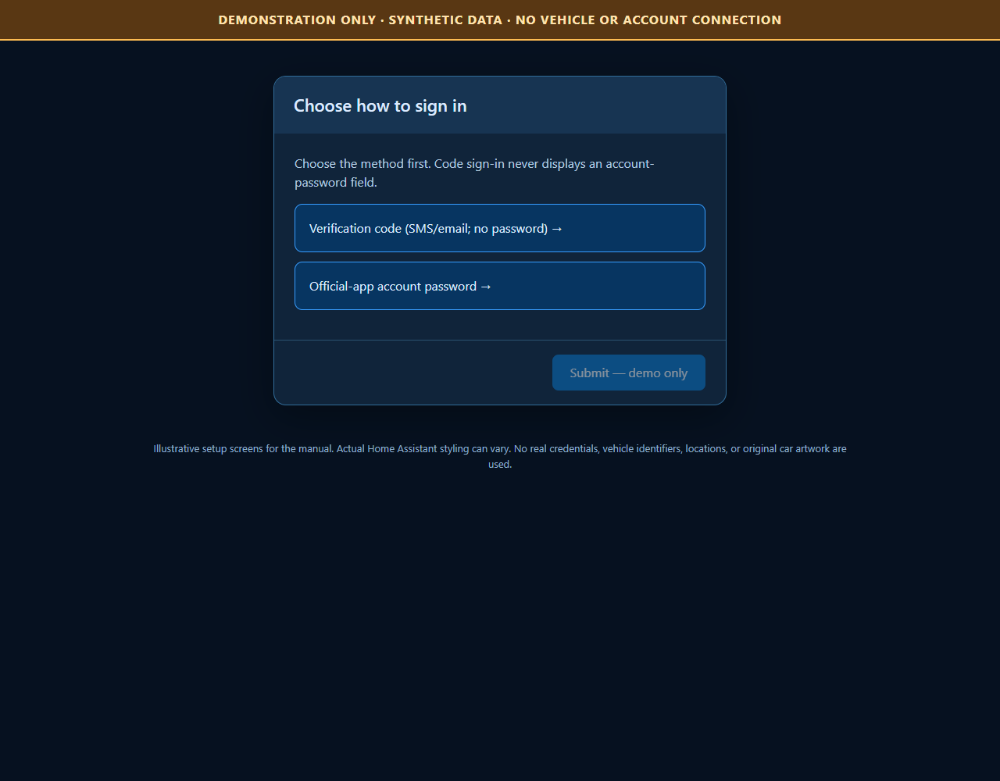
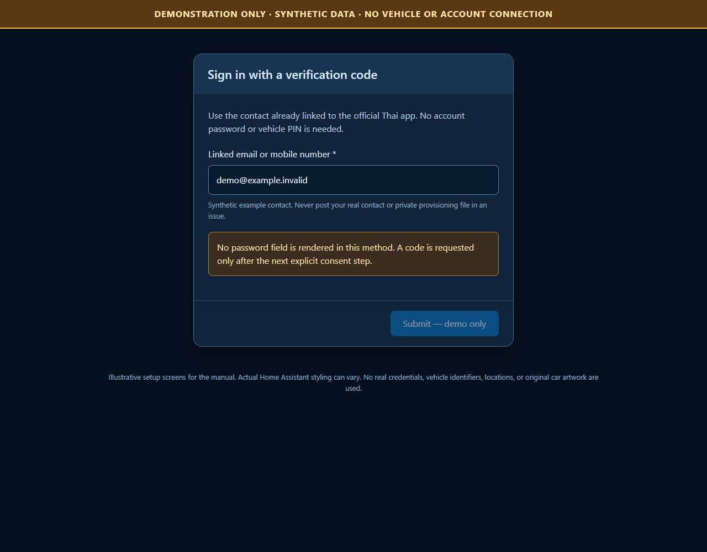
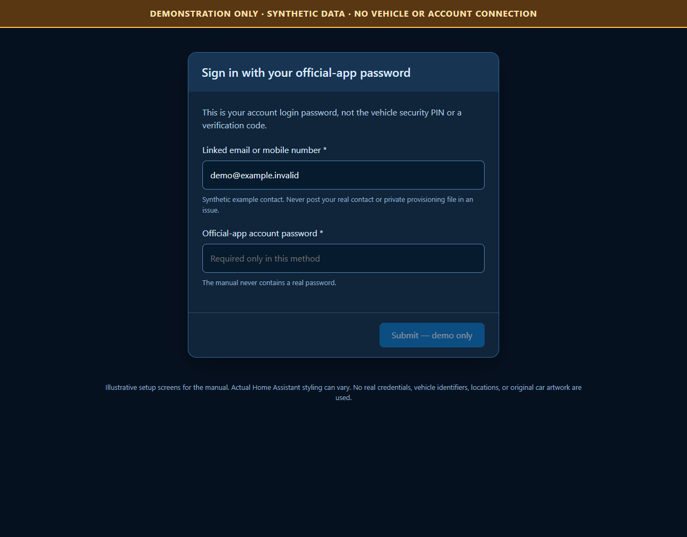
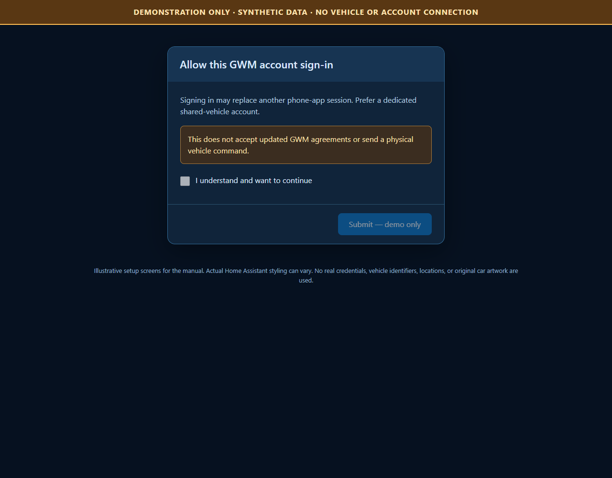
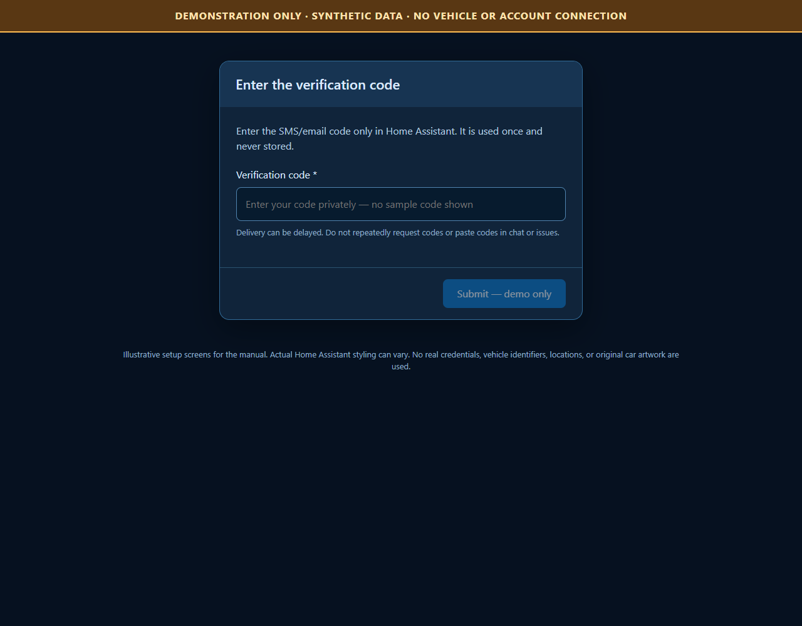

# Installation manual

All pictures here are **synthetic examples**, not a live owner's Home Assistant. They contain no usable app material or credentials. Actual HA layout can vary.

## Prerequisites

- Home Assistant **2026.10.0+**, with administrative access and a recent backup.
- A Thailand-region account and vehicle already working in the official app.
- A lawful local copy of **My GWM Thailand 3.0.8**, package `com.gwm.tha`.
- A trusted development computer with Python **3.14** for the provisioning CLI. No Android emulator or APK execution is needed.
- Normal outbound verified HTTPS from Home Assistant to GWM's Thai gateways.
- Prefer a dedicated, authorized shared-vehicle account. A new login can replace another device's session.

The reviewed APK SHA-256 is:

```text
7594b52138ad8c36a5c426321e251c899dead78ab578bdc548e7db4a6e26c7f3
```

An unknown/different APK is rejected instead of guessing offsets or using another region's material. This repository does not host APKs or direct copies of application certificate/private-key resources.

## 1. Install the integration

### HACS custom repository

1. Install HACS using [its official instructions](https://www.hacs.xyz/docs/use/).
2. In HACS, choose the menu **Custom repositories**.
3. Add `https://github.com/zangkasi55/gwm-thailand-connect`.
4. Select category **Integration**, then add the repository.
5. Find **GWM Thailand Connect**, download a release, and restart Home Assistant.

If HACS later lists this project by default, the custom-repository step may be skipped. **Submitting for inclusion is not the same as approval.**

### Manual release archive

1. Download `gwm-thailand-connect-VERSION.zip` from [Releases](https://github.com/zangkasi55/gwm-thailand-connect/releases).
2. Verify its SHA-256 against the release's `SHA256SUMS`.
3. Extract it into your HA configuration directory. The result must be:

```text
<HA configuration>/
  custom_components/
    gwm_thailand_connect/
      __init__.py
      manifest.json
      frontend/
      gwm_client/
```

Do not put an extra ZIP/root directory between `custom_components` and `gwm_thailand_connect`. Restart Home Assistant after copying.

## 2. Generate private provisioning

Clone/download the repository on your trusted computer. The CLI needs only the declared runtime packages, not an installation of Home Assistant:

```text
python -m venv .venv
```

Activate the environment, then run:

```text
python -m pip install -r requirements-provisioning.txt
python scripts/export_thailand_material.py "<path-to-your-reviewed.apk>" "<private-output-path.json>"
```

On Windows the environment's interpreter can also be used directly:

```powershell
.\.venv\Scripts\python.exe -m pip install -r requirements-provisioning.txt
.\.venv\Scripts\python.exe scripts\export_thailand_material.py "C:\Private\official.apk" "C:\Private\app-material.json"
```

The paths above are examples, not files supplied by the project. Choose a private location **outside your Git checkout and any shared/cloud-synced folder**.

The CLI:

- checks the exact reviewed APK and resource fingerprints;
- derives and validates private provisioning locally;
- creates a new output file and refuses to overwrite an existing file;
- never signs in, requests a code, talks to a vehicle, or prints private bytes.

On Unix the newly created file uses owner-only permissions. On Windows, `0600` is not a complete NTFS ACL guarantee: keep it in an access-controlled local directory. Do not upload it to GitHub, issue attachments, email or chat.

## 3. Add GWM Thailand Connect

Open **Settings > Devices & services > Add integration**, search for **GWM Thailand Connect**.

### Import private material

Select the generated private JSON. It is validated, imported into HA's private storage, and is not a public dashboard resource.



If validation fails, check the APK version/hash and regenerate locally. Do not disable certificate validation.

### Choose the login method



**Verification code** is appropriate when your account supports SMS/email sign-in:



- Enter the contact already linked to the official Thai app.
- There is **no account-password field** in this method.
- Do not enter your vehicle security PIN as an account credential.

**Official-app password** displays and requires the account-password field:



The password is the official account login password, not an OTP or the separate vehicle PIN. GWM may require additional verification.

### Confirm the session warning



A code/account login is requested only after explicit consent. This can replace a phone session. It does not accept updated GWM agreements on your behalf and does not send a physical command.

### Enter the verification code privately



SMS/email delivery may be delayed. Use the delivered code only in HA's private form. Do not repeatedly restart setup or request codes, and do not run a separate code-precheck that could consume the login code.

### Complete certificate initialization

After account sign-in is accepted, the integration generates its own account/device-bound RSA key and CSR and validates the returned certificate.

If initialization is pending, follow the continuation form. The accepted session, encrypted generated key, original CSR and any returned certificate are retained privately. Retrying initialization does not deliberately perform another account login.

If GWM returns `310022` without certificate data, an explicit recovery step can create and normally verify a **fresh integration device**. It does not reuse old tokens under a new device ID or silently revoke a phone certificate.

## 4. Check the device and readings

After setup, open the created GWM device. Compare battery, lock, door and A/C states with the official app and check reported cloud timestamps. Cached data is not proof the vehicle is online.

An absent value stays `unknown`; an unavailable account does not become a fake zero/closed/locked reading. Remote controls remain off by default.

## 5. Add the dashboard

The integration serves its card locally after successful setup; no external JS/CDN is needed.

1. In **Settings > Dashboards > Resources** (advanced mode may be needed), add:
   - URL: `/gwm_thailand_connect/dashboard/gwm-thailand-card.js?v=0.3.1`
   - Type: **JavaScript module**.
2. Add a new, empty dashboard.
3. Set title **Haval** or **GWM Thailand**, URL path **`gwm-thailand`**, and enable **Show in sidebar**.
4. Take control of the dashboard if prompted.
5. Open its raw configuration editor and paste [the supplied dashboard YAML](../dashboards/gwm-thailand.yaml).
6. Save and reload the page.

The card's details link expects `/gwm-thailand/details`, so keep the URL path above.

For an individual card instead of the full example:

```yaml
type: custom:gwm-thailand-card
```

The same module also registers `custom:gwm-journey-card`. The supplied dashboard adds
a **Journeys & parking** sub-tab at `/gwm-thailand/journeys`. Recording is opt-in;
see [journey history](journeys.md) and [local OpenStreetMap setup](openstreetmap.md). This feature is for 0.3.0 development builds,
not the published 0.1.0 release.

If several vehicles exist, the card provides a selector. To pin one card to a vehicle, use its **Home Assistant device registry ID**, not its VIN:

```yaml
type: custom:gwm-thailand-card
device_id: YOUR_HA_DEVICE_REGISTRY_ID
```


## 6. Optional remote controls

Read [the user guide](user-guide.md#optional-remote-controls) before enabling them. They are not needed for telemetry.

## Updates and uninstall

- Back up first. Install the next release through HACS, or replace only the component directory manually, then restart.
- Reload the browser after updating the resource version.
- Keep private provisioning and HA backups protected.
- Remove the integration entry before deleting the component. Removing an entry removes its integration account-state journal. The shared private app-material store remains on the HA host for any other entries.
- No automatic migration from `gwm_ora` is performed. Do not copy old account/device state between domains.
