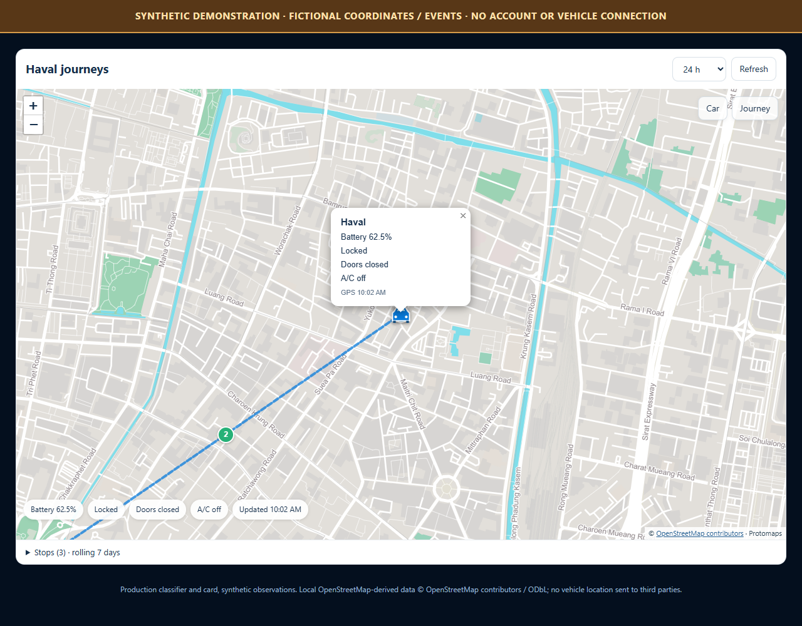
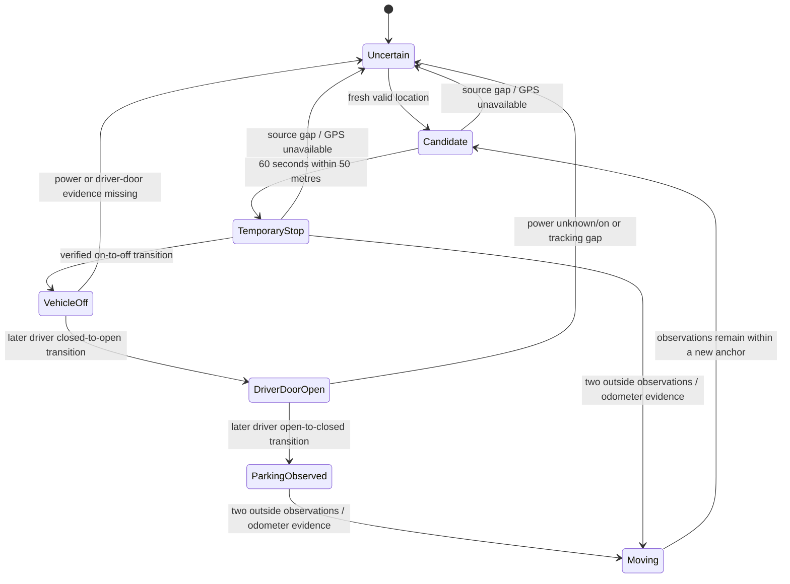

# Haval journeys, temporary stops and parking

This is a **0.3.x development feature**, not part of the published 0.1.0 release.
It records observations on your own HA host after explicit opt-in. It is not
continuous GPS tracking, a security device or a manufacturer trip log.



The screenshot is generated from fictional coordinates/events using the real
classifier and card. It contains no owner journey.

## What can actually be observed

The Thai status DTO supports optional GPS coordinates, battery SOC, odometer,
four doors/boot, lock state and cloud acquisition/update timestamps. A field's
presence in the protocol does not prove that every vehicle currently reports it.

The raw engine-state code has **not** been established as a reliable ignition
state. PHEV combustion engines can stop while driving. Accordingly:

- the interface reports **inferred movement starts/stops**, not engine ON/OFF;
- raw engine-code changes are labelled unverified;
- exact arrival/departure and door-opening/closing times cannot be reconstructed
  between cloud updates;
- location reporting, a valid GWM session and fresh source timestamps are needed.

The decoder reads the optional top-level hybrid power field `hyEngSts`, which
the reviewed native app uses for vehicle power separately from engine state.
Only explicit `0`/`"0"` (off) and `1`/`"1"` (on) populate `vehicle_power_off`.
Missing, unknown or noncanonical states remain unknown; malformed types are
rejected. Neither service expiry, gear nor raw engine code `2016001` substitutes
for this signal.

The reference car's sampled HTTP responses have **not** supplied this field.
Protocol support is not proof of live availability: those observations still
remain **parking unconfirmed**. The synthetic tests exercise the real parser
through the ordered parking rule, but are not evidence of a physical parking
event or of the owner's cloud account reporting power.

Opening this view does not wake, start, unlock or otherwise control the car.

## Enable and open

1. Install the development build and restart HA.
2. Open integration options and enable **Record private journey observations
   (rolling seven days only)**. No vehicle PIN or remote-control opt-in is needed.
3. Retention is fixed at **seven rolling days**, with no longer-retention setting.
   Recording continues while enabled; it does not stop after seven days. The
   20,161-sample safety cap accommodates seven days at 30-second polling.
4. Add the **Journeys & parking** dashboard view from the supplied dashboard.
   The main card resource registers both custom elements.
5. Set up a [local OpenStreetMap archive](openstreetmap.md), then open the Haval/GWM
   sidebar dashboard and select the sub-tab.

```yaml
type: custom:gwm-journey-card
```

The older private `gwm_ora` adapter uses the same card with:

```yaml
type: custom:gwm-journey-card
domain: gwm_ora
```

Use only the adapter you actually installed; do not configure the same account
twice or copy account keys between domains.

## Parking rule: stop, vehicle shutdown, driver door open then closed

| Label | Evidence required |
| --- | --- |
| Temporary stop / vehicle on | At least two fresh GPS observations spanning **60 seconds**, within **50 m**, with verified vehicle/READY power still on |
| Parking sequence observed | In the same stationary cluster: verified vehicle power changes **on to off**, then the **driver** door changes closed to open, then open to closed, in separate ordered observations |
| Stopped / parking unconfirmed | Stationarity is observed, but the required verified power or ordered driver-door evidence is missing |

**No five-minute/15-minute timer, lock action, passenger door or combustion-engine
pause substitutes for this sequence.** The sequence is high-confidence evidence,
not proof that the driver physically exited: occupancy is not observed, and
timestamps/GPS remain sampled estimates. Odometer increases of at least
0.05 km prevent a stationary cluster from being extended despite noisy/frozen GPS.
Leaving the cluster needs two outside observations before movement is confirmed;
one displaced GPS sample does not become a trip.

The radius/time defaults deliberately favor uncertainty. A stop shorter than a
minute can be missed or remain unconfirmed. A 50 m radius also cannot distinguish
nearby parking spaces.



## Stops, battery and doors

The **Refresh** button requests the integration's normal cached cloud read before
loading current status and history. It does not wake the vehicle, call
`vehicle/findStatus`, or publish a command. An old manufacturer timestamp remains
old; clicking Refresh never makes a stale fix current. Automatic card reloads
continue to read the local observations without requesting an additional cloud
read. Unloaded accounts, permission failures and unsuccessful cloud reads are
reported explicitly.

The page is map-first, with compact battery/lock/door/A/C chips and a car marker.
Select the car for its status popup. Open **Stops** or select a numbered marker to see:

- first and last observed times, dwell span and whether arrival/departure was
  actually observed;
- SOC in the first sample and latest reported SOC at that stop, with its timestamp;
- door/boot opening episodes associated with the stop;
- a door's estimated first-open to first-closed interval and observed-open span.

An observed parking sequence includes separate power-off, driver-open and
driver-closed timestamps. If shutdown and opening first appear together in one
cloud sample, their order is unknown and parking is not confirmed. Starting a
recording with the vehicle already off/open does not fabricate a shutdown or
driver-door transition. A later restart invalidates the current parking sequence
without deleting the fact that a sequence was observed earlier at that stop.

An initially open door is labelled **start not observed**. Missing door state or
a tracking gap ends continuity without fabricating a closure. Brief closing and
reopening between polls cannot be excluded, even in an apparently continuous
episode. Unknown SOC remains unknown, not zero.

The movement timeline shows the first position evidencing departure, the start
of a newly stationary cluster, the SOC at each observation, and when later samples
confirmed the inference. These are not exact physical start/stop timestamps.

## Freshness and gaps

- Cloud **acquisition time** takes precedence over a newer backend update time.
- Samples older than **5 minutes**, more than 30 seconds in the future, or
  lacking a timezone-aware source timestamp are rejected with an input-quality
  status.
- Duplicate/out-of-order source timestamps do not extend durations.
- Gaps over **5 minutes** break route segments, stop continuity and door intervals.
- Implausible GPS jumps above 200 km/h are not drawn or used as stop locations.
- When fresh data stops, durations **freeze** at the last accepted observation.
  The UI does not count wall-clock time as proof the car remains parked or a
  door remains open.

History starts when recording is enabled. No old route is invented or backfilled
from the car's present position.

Keep normal cloud polling short enough to obtain multiple observations, for
example 60-120 seconds. A polling interval over five minutes intentionally cannot
establish continuous stop/door intervals under these gap rules; polling faster
still does not force the manufacturer's cache to update.

## Map and privacy

The map uses locally bundled **Leaflet** and a same-host **OpenStreetMap-derived
PMTiles** archive. It supports panning/zooming, a recent car marker with a compact
status popup, numbered stops, **Car** focus and **Journey** fit. There is no CDN.

The current marker requires a valid manufacturer fix no more than five minutes
old. Poll receipt time does not make old coordinates current. Missing/invalid/
future/stale GPS leaves the car position **blank**, with no assumed Bangkok/home
location. A current position is available even when history recording is off;
precise-location access still requires administrator/device permissions.

Dashed lines join observed positions, not the actual road driven. Separate
segments make coverage gaps visible. Historical points are not presented as the
car's current location. Vehicle coordinates, status and viewport are never sent
to Google, OpenStreetMap, a CDN or an analytics service. The generic country
archive is obtained independently of vehicle data and served from your HA.

See [OpenStreetMap setup](openstreetmap.md) for the default local archive,
licensing/attribution, data-zoom limits and optional local tile sources.

If you already host lawfully obtained offline XYZ tiles in HA's local directory,
you may configure a local-only background:

```yaml
type: custom:gwm-journey-card
local_tile_url: /local/offline-map/{z}/{x}/{y}.png
```

External URLs, protocol-relative paths and traversal paths are rejected.
The release does not bundle a country archive or bulk-download public raster
tiles. Missing map data is reported explicitly rather than switching to an
external provider. OpenStreetMap attribution stays visible on the map.

Precise route access is **administrator-only**, with additional per-device HA
permission/ownership checks. History is served through authenticated WebSocket
requests, never a public JSON file or sensor attribute. Ordinary telemetry-read
access is not enough to read GPS history.

Expiry is scheduled at the oldest sample's seven-day deadline, independently of
cloud polling, account connection, dashboard access or recording being enabled.
Startup and read/write pruning enforce the same fixed limit. HA must be running
to delete files; if it was off, overdue data is pruned when HA starts again.
Pruning failures are logged, reported as storage failures, and retried locally.
Disabling recording stops new collection; it does not immediately erase unexpired
history. Deleting an
integration entry removes its history store. The view's explicit deletion control
clears only the selected vehicle's history, not credentials or another vehicle.
Protect HA backups too; normal file deletion is not forensic secure erasure.
The integration does not rewrite or delete your existing HA backups; copies in
those backups follow your separate backup-retention policy.
