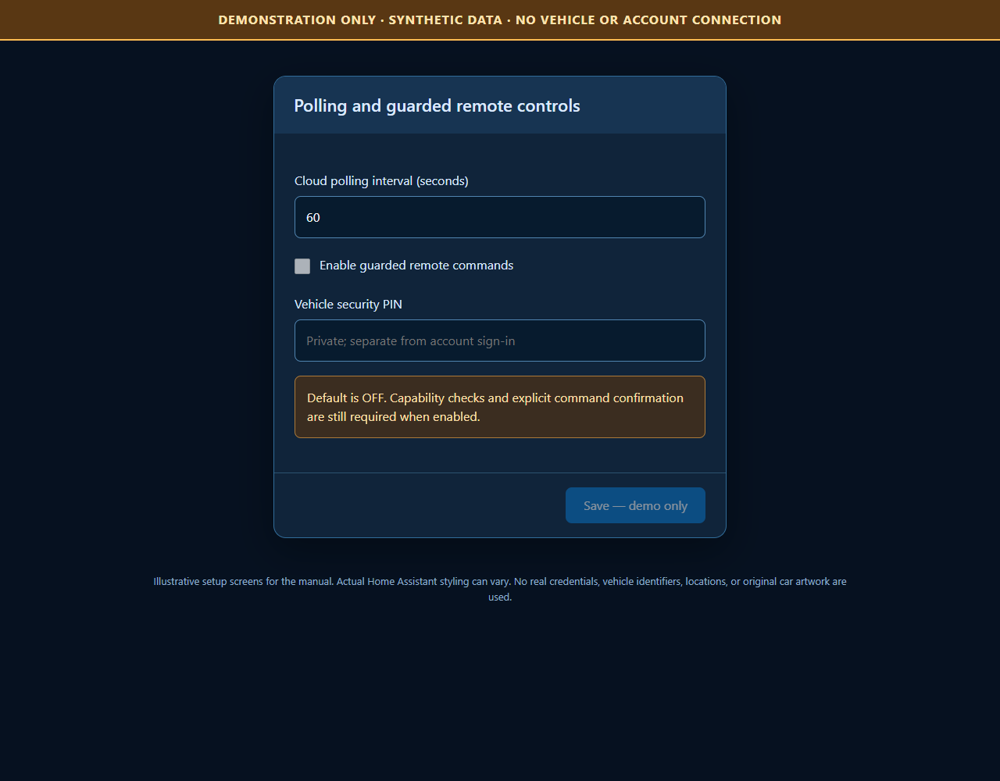
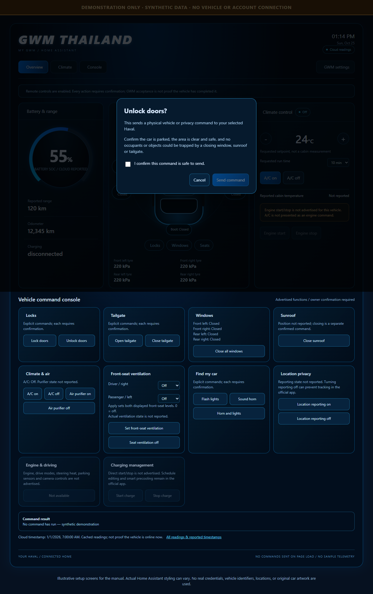
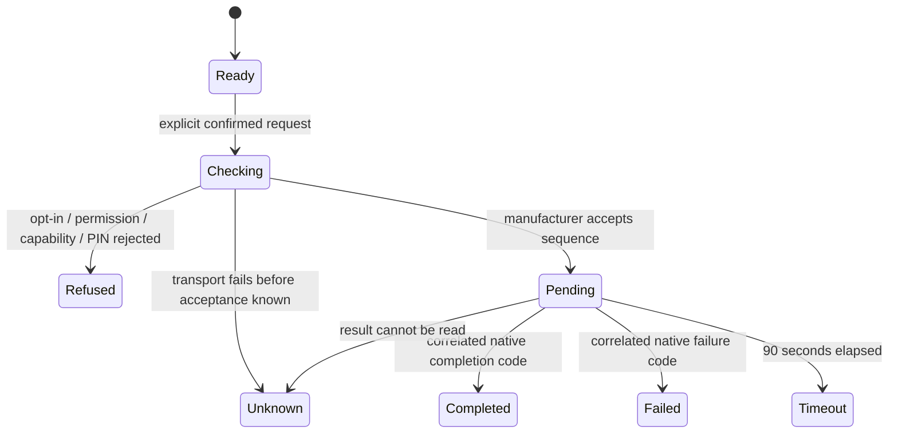

# Using GWM Thailand Connect

## Readings and freshness

The integration polls cached cloud status (default: **60 seconds**, configurable **30-3600 seconds**). A faster poll does not force the car to wake or guarantee fresher data.

| Reading | Meaning |
| --- | --- |
| Battery level | Cloud-reported traction battery SOC, not a fabricated charging estimate |
| Range / odometer | Reported kilometres |
| Lock open | `on` = unlocked; `off` = locked; unknown is neither |
| Four door sensors / boot | `on` = open; `off` = closed; unknown is neither |
| Air conditioning | Reported on/off when present |
| Cabin temperature | Reported measurement only; may remain unknown |
| Tyres | Pressure (kPa) and temperature when the backend supplies them |
| Charging indicators | Reported status, plug presence, active flag and remaining time when present |
| Command status | Locally tracked outcome, not an automatic successful result |

The **Overview**, **Climate** and **Console** tabs are views inside the card. **All readings** is a separate dashboard view.

The car outline is a generic CSS drawing, not model-specific engineering artwork. Door positions are labelled for the Thai right-hand-drive reference vehicle. Confirm mappings for other models before relying on them.

## Optional remote controls

Opening a dashboard, viewing telemetry, choosing login type, updating an entity or restarting HA does **not** send a vehicle command.

1. Open **Settings > Devices & services > GWM Thailand Connect > Configure**.
2. Enable guarded remote commands only when authorized to control the car.
3. Enter the **vehicle security PIN** privately. This is separate from account password and verification code. Recover/reset it using the official app's supported process; the integration cannot reveal it.
4. Save the options.

A blank PIN retains an existing PIN while controls stay enabled. Disabling controls removes the PIN from integration options. The PIN is not printed or shown in dashboard attributes.

Only the capabilities freshly advertised by GWM for the selected vehicle are eligible. The integration implements fixed, reviewed operations for:

- locking/unlocking;
- flash/horn/find-car actions;
- tailgate opening/closing, all-window closing, sunroof closing;
- A/C and purifier on/off;
- front-seat ventilation settings/off;
- location-reporting on/off.

Availability varies by vehicle and account role. No arbitrary endpoint or command payload is exposed.

### Send exactly one explicit command

1. Ensure the vehicle is safely parked, the area is clear, and no occupant or object could be trapped.
2. Select the correct car.
3. Choose a supported action.
4. Read the confirmation, check the safety checkbox, and press **Send command**.
5. Wait for command status. Do not repeat a command merely because a network error occurred.

For climate, **16-32 degrees C** and **5-30 minutes** are requested settings, not measured cabin values. Seat controls set both shown front-seat levels; `0` means off. Turning off location reporting may prevent the official app from tracking the vehicle.

### Command outcomes

Manufacturer **acceptance is not completion**. A timeout or connection failure is **not proof nothing happened**. Check the vehicle before another explicit attempt. Accepted commands are persisted; after HA restarts, only result polling resumes, never a command resend.

Automations can call the integration service only with the same opt-in, PIN and capability gates. A user-originated service call also needs HA control permission for the selected vehicle. Automation contexts without a user ID rely on the HA administrator's trusted automation configuration. Do not expose the service through untrusted webhooks.

The example dashboard deliberately adds no unguarded actuator entities.

## Unsupported features

- No engine start/stop, drive mode, camera, parking-sensor or steering-heat control is invented from a UI label.
- No charging schedules or direct charging-start/stop writes.
- No forced vehicle wake.
- Release 0.1.0 has no journey history. The 0.3.x development builds add [compact OpenStreetMap journey history](journeys.md); they do not reconstruct missed samples or exact ignition/door timing.
- No bypass of official account challenges, agreements, session conflicts or authorization.

## Multiple integrations and phone sessions

GWM can limit simultaneous sessions. Running this and another integration against the same account, or logging into the phone, can invalidate a cloud session. Prefer an official shared-vehicle account where supported. Reconnection is an owner action, not an automatic session takeover.
